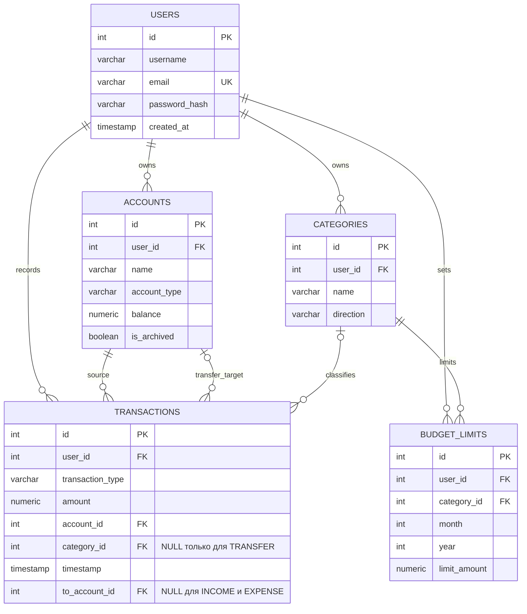
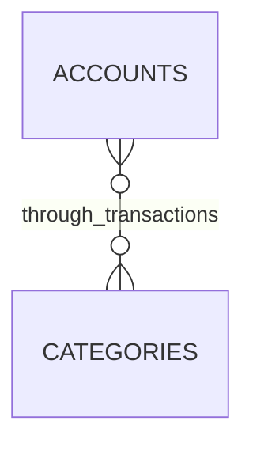

# ER-диаграмма CapitalTracker

Схема лабораторной работы № 4 спроектирована по существующим доменным
сущностям. Пользователь владеет счетами, категориями, операциями и лимитами.

## Связь «многие ко многим»

Один счет участвует в операциях разных категорий; одна категория используется
на разных счетах. Физическая связь хранится в `transactions`, где также
записаны сумма, дата и тип операции. Повторные операции одной пары допустимы:
у каждой операции собственный PK. Переводы не имеют категории и в M:N не входят.

`AccountORM.categories` и `CategoryORM.accounts` используют `secondary`,
`back_populates`, `viewonly=True`. Эти коллекции отражают историю операций,
а не справочник разрешенных категорий. Создание и удаление связи выполняются
через финансовую операцию с пересчетом баланса. После изменения операций
загруженную коллекцию нужно обновить через `Session.expire` или новую сессию.

## Ограничения и индексы

| Таблица | Ограничения |
| :--- | :--- |
| Все таблицы | Целочисленный PK `id`; поля обязательны, кроме двух явно указанных полей операций |
| `users` | `UNIQUE(email)`; непустое имя пользователя |
| `accounts` | FK на владельца; `UNIQUE(user_id, id)` для составных FK; непустое имя; конечный баланс; тип из `DEBIT`, `CREDIT`, `CASH`, `SAVINGS` |
| `categories` | FK на владельца; `UNIQUE(user_id, id)`; непустое имя; направление `INCOME` или `EXPENSE` |
| `transactions` | FK на владельца; составные FK `(user_id, account_id)`, `(user_id, to_account_id)`, `(user_id, category_id)` запрещают ссылки на чужие данные; положительная конечная сумма; допустимый тип |
| `transactions` | Для `TRANSFER`: целевой счет обязателен и отличается от исходного, категория отсутствует. Для `INCOME`/`EXPENSE`: категория обязательна, целевой счет отсутствует |
| `budget_limits` | FK на владельца; составной FK на категорию того же владельца; `UNIQUE(user_id, category_id, month, year)`; месяц 1–12, год 1970–2100; положительный конечный лимит |

Все денежные колонки имеют тип `NUMERIC(18, 2)` и отображаются в `Decimal`.
Ограничения диапазона исключают также `NaN` и бесконечности; отрицательный
баланс допускается. Проверка соответствия типа операции направлению категории
выполняется сервисом, поскольку это правило затрагивает разные таблицы.

На `user_id` всех дочерних таблиц созданы индексы; у операций индексированы
`account_id`, `category_id`, `to_account_id`, у лимитов — `category_id`.
Время хранится без часового пояса, как в прототипе: календарные месяцы
бюджетов рассчитываются по локальному времени приложения.

## Каскады и сохранение истории

Все FK используют `ON DELETE RESTRICT`. Используемые счета и категории
нельзя удалить вместе с историей. Счет архивируется через `is_archived`.

ORM-связи 1:N сохраняют стандартный каскад `save-update, merge`, но не
каскадное удаление. `passive_deletes="all"` оставляет проверку удаления БД,
в том числе если коллекции уже загружены: ORM не обнуляет внешние ключи.
Связи M:N доступны только для чтения и не создают побочных удалений.

Схема приложения создается исключительно миграциями Alembic.
